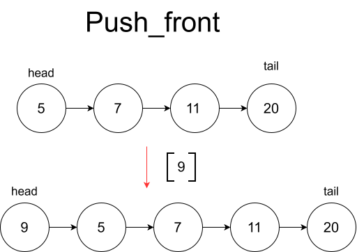
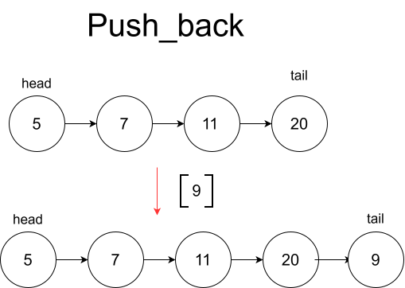
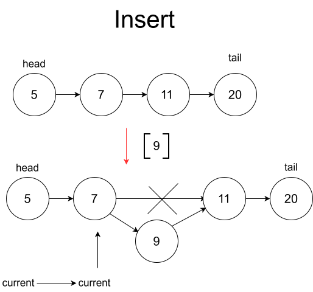
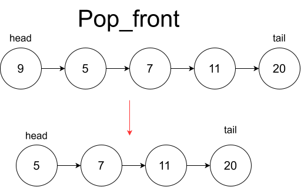
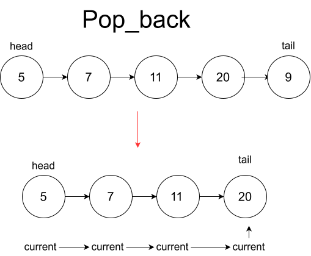
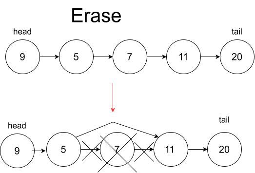

# class ListNode

`ListNode` — это шаблонный класс, реализующий структуру данных «односвязный список». Каждый элемент списка (узел `Node`) хранит данные (`data_`) и указатель на следующий элемент (`next_`). 

Ключевая особенность данной реализации — наличие указателя `tail_` на последний элемент и счётчика `size_`. Это позволяет выполнять операции добавления в конец списка за константное время, сохраняя при этом минимальные накладные расходы на память (всего один указатель на узел вместо двух, как в двусвязном списке).

## Способы возможной реализации

1. **Классический односвязный список:** хранится только указатель на голову (`head_`). Операция добавления в конец (`push_back`) требует полного обхода списка за O(N) для поиска последнего элемента.
2. **Односвязный список с указателем на tail (выбранный):** хранятся указатели на `head_` и `tail_`, а также счётчик `size_`. Обеспечивает O(1) для `push_back`, но удаление с конца (`pop_back`) всё равно требует O(N), так как необходимо найти предпоследний узел.
3. **Двусвязный список (Doubly Linked List):** каждый узел хранит указатели на предыдущий и следующий элементы. Позволяет выполнять все операции с концами списка за O(1), но удваивает расход памяти на указатели и усложняет логику управления памятью.

### Ближайший аналог
`std::forward_list` (в C++ не имеет `tail_`, поэтому не имеет быстрого `push_back`), `java.util.LinkedList` (реализован как двусвязный список).

## Особенности реализации базовых операций

### Вставки

* **Вставка в начало (`push_front`)**

  #### Описание алгоритма:
  1. Создать новый узел `tmp`, указывающий на текущий `head_`, с переданным значением.
  2. Обновить `head_ = tmp`.
  3. Если список был пуст (`isEmpty()`), дополнительно обновить `tail_ = tmp`.
  4. Увеличить `size_` на 1.
  **Сложность: временная O(1), пространственная O(1).**

* **Вставка в конец (`push_back`)**

  #### Описание алгоритма:
  1. Создать новый узел `tmp` с `next_ = nullptr`.
  2. Если список пуст, установить `head_ = tmp`.
  3. Иначе связать текущий конец с новым узлом: `tail_->next_ = tmp`.
  4. Обновить указатель конца: `tail_ = tmp`.
  5. Увеличить `size_` на 1.
  **Сложность: временная O(1), пространственная O(1).**

* **Вставка по индексу (`insert_ind`)**

  #### Описание алгоритма:
  1. Если `index >= size_`, выбросить исключение `std::out_of_range`.
  2. Если список пуст или `index == 0`, делегировать выполнение методу `push_front`.
  3. *(Примечание: ветка `index == size_` в текущем коде недостижима из-за первой проверки, см. раздел "Рекомендации")*.
  4. Иначе: пройти от `head_` до узла с индексом `index - 1`.
  5. Создать новый узел `tmp`, указывающий на `current->next_`.
  6. Встроить узел: `current->next_ = tmp` и увеличить `size_` на 1.
  **Сложность: временная O(N), пространственная O(1).**

* **Вставка после конкретного узла (`insert`)**
  #### Описание алгоритма:
  1. Создать новый узел `tmp`, указывающий на `elem->next_`.
  2. Если `elem` был последним элементом (`elem->next_ == nullptr`), обновить `tail_ = tmp`.
  3. Встроить узел: `elem->next_ = tmp` и увеличить `size_` на 1.
  **Сложность: временная O(1), пространственная O(1).**

### Удаление

* **Удаление из начала (`pop_front`)**

  #### Описание алгоритма:
  1. Если список пуст, выбросить исключение `std::logic_error`.
  2. Сохранить указатель на следующий узел: `tmp = head_->next_`.
  3. Если `tmp == nullptr` (в списке был ровно один элемент), обнулить `tail_`.
  4. Сохранить данные из `head_->data_` для возврата.
  5. Удалить `head_` и обновить `head_ = tmp`.
  6. Уменьшить `size_` на 1 и вернуть сохранённые данные.
  **Сложность: временная O(1), пространственная O(1).**

* **Удаление из конца (`pop_back`)**

  #### Описание алгоритма:
  1. Если список пуст, выбросить исключение `std::logic_error`.
  2. Если `size_ == 1`, делегировать выполнение методу `pop_front` (оптимизация, избегающая лишнего обхода).
  3. Иначе: пройти от `head_` циклом до предпоследнего узла (индекс `size_ - 2`).
  4. Разорвать связь: `current->next_ = nullptr`.
  5. Сохранить данные из `tail_->data_` для возврата.
  6. Удалить старый `tail_`, обновить `tail_ = current`.
  7. Уменьшить `size_` на 1 и вернуть сохранённые данные.
  **Сложность: временная O(N), пространственная O(1).** 
  *Почему O(N)?* Несмотря на наличие `tail_`, для корректного удаления последнего элемента необходимо найти *предшествующий* ему узел, чтобы обнулить его указатель `next_`. В односвязном списке это требует линейного прохода.

* **Удаление по индексу (`erase`)**

  #### Описание алгоритма:
  1. Если список пуст, выбросить `std::logic_error`. Если `index > size_ - 1`, выбросить `std::out_of_range`.
  2. Если `index == 0`, делегировать выполнение методу `pop_front`.
  3. Если `index == size_ - 1`, делегировать выполнение методу `pop_back`.
  4. Иначе: пройти от `head_` до узла с индексом `index - 1`.
  5. Сохранить указатель на удаляемый узел: `tmp = current->next_`.
  6. Сохранить его данные для возврата.
  7. Исключить узел из цепочки: `current->next_ = tmp->next_`, удалить `tmp` и уменьшить `size_` на 1.
  **Сложность: временная O(1) в лучшем случае (граничные индексы), O(N) в среднем и худшем.**

### Поиск

* **Линейный поиск (`find`)**
  #### Описание алгоритма:
  1. Если список пуст, вернуть `nullptr`.
  2. Итерировать указатель `current` от `head_`, пока `current->next_` не равен `nullptr`.
  3. На каждом шаге сравнивать `current->data_` с искомым значением. При совпадении вернуть `current`.
  4. После цикла отдельно проверить данные последнего узла (так как условие цикла `while (current->next_)` не проверяет последний элемент).
  5. Вернуть `current` при совпадении или `nullptr`, если элемент не найден.
  **Сложность: временная O(N), пространственная O(1).**

## Таблица сложности

| Операция | Временная сложность (Лучшая) | Временная сложность (Худшая) | Временная сложность (Средняя) | Пространственная сложность |
| :--- | :---: | :---: | :---: | :---: |
| **push_front** | O(1) | O(1) | O(1) | O(1) |
| **push_back** | O(1) | O(1) | O(1) | O(1) |
| **insert (по указателю)**| O(1) | O(1) | O(1) | O(1) |
| **insert_ind (по индексу)**| O(1)* | O(N) | O(N) | O(1) |
| **pop_front** | O(1) | O(1) | O(1) | O(1) |
| **pop_back** | O(N) | O(N) | O(N) | O(1) |
| **erase (по индексу)** | O(1)* | O(N) | O(N) | O(1) |
| **find** | O(1) | O(N) | O(N) | O(1) |

*\* O(1) достигается в граничных случаях (индекс 0 или `size_ - 1`), когда операция делегируется методам начала или конца списка.*

## Назначение

1. **Реализация эффективной очереди (Queue)**
   Комбинация `push_back` за O(1) и `pop_front` за O(1) делает эту структуру идеальной базой для FIFO-очередей. В отличие от `std::vector`, здесь нет затрат на реаллокацию памяти или сдвиг элементов.
2. **Стек (Stack) с динамическим ростом**
   Использование `push_front` и `pop_front` обеспечивает полноценный LIFO-стек, который не ограничен фиксированной ёмкостью и гарантирует O(1) для всех операций без скрытых затрат на копирование.
3. **Хеш-таблицы с разрешением коллизий (Separate Chaining)**
   Метод `insert(Node<T>* elem, const T& value)` позволяет вставлять элементы за O(1), если у вас уже есть итератор или указатель на нужный узел. Это идеально подходит для добавления элементов в цепочки коллизий хеш-таблиц.
