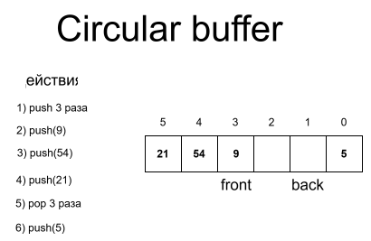
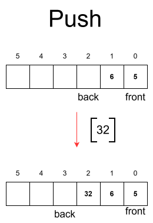
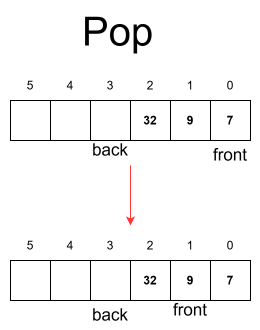

# class Queue 

Queue (Очередь) — это абстрактный тип данных, реализующий структуру «первым пришёл — первым вышел» (FIFO — First In, First Out). Элементы добавляются в конец очереди и извлекаются из её начала. В данной реализации используется **статический массив** фиксированного размера с организацией в виде **кольцевого буфера** (circular buffer), что позволяет эффективно использовать выделенную память без физического сдвига элементов.

## Способы возможной реализации

1) **Линейный массив с двумя указателями:** `front` указывает на начало, `back` — на конец. При удалении из начала указатель `front` сдвигается вправо. Проблема: после серии `push`/`pop` свободное место в начале массива не используется, и очередь «упирается» в конец, даже если фактически есть свободные ячейки.
2) **Кольцевой буфер (Circular Buffer):** указатели `front` и `back` двигаются по модулю размера массива. Когда `back` достигает конца массива, он «перепрыгивает» в начало. Это решает проблему линейного массива и позволяет использовать всю выделенную память.
3) **Связанный список:** каждый элемент — узел с указателем на следующий. Не имеет ограничения по размеру, но требует дополнительной памяти на указатели и ухудшает локальность кэша.

### Ближайший аналог нашей реализации
`std::queue` (в C++ по умолчанию использует `std::deque`), `java.util.ArrayDeque`, `collections.deque` в Python.

### Выбранный способ реализации
Для разработки выбран **статический кольцевой буфер** фиксированного размера `size`. Размер очереди задаётся на этапе компиляции или инициализации и не может быть изменён в процессе работы. Для различения пустого и полностью заполненного состояния жертвует лишней переменной `count`: очередь считается полной, когда `count == size`.

## Особенности реализации базовых операций

### Вставки

* Добавление в очередь (push)

#### Описание алгоритма:
Проверить, не заполнена ли очередь: `count == size`. Если да — вернуть ошибку переполнения.
Записать новый элемент по индексу `back`.
Сдвинуть указатель `back = (back + 1) % size`.Количество элементов +1.
**Сложность: временная O(1), пространственная O(1).**

### Удаление

* Удаление из очереди (pop)

#### Описание алгоритма:
Проверить, не пуста ли очередь: `count == 0`. Если пуста — вернуть ошибку.
Сохранить значение элемента по индексу `front` (нужно вернуть его).
Сдвинуть указатель `front`: `    front = (front + 1) % size`. Количество элементов -1.
**Сложность: временная O(1), пространственная O(1).**
*Особенность:* в отличие от линейного массива, освобождённая ячейка в начале очереди автоматически становится доступной для новых `push` благодаря кольцевой структуре — никакого физического сдвига данных не требуется.

## Таблица сложности

| Операция | Временная сложность (Лучшая) | Временная сложность (Худшая) | Временная сложность (Средняя) | Пространственная сложность (Лучшая) | Пространственная сложность (Худшая) | Пространственная сложность (Средняя) |
| :--- | :---: | :---: | :---: | :---: | :---: | :---: |
| **push (Вставка)** | O(1) | O(1) | O(1) | O(1)| O(1) | O(1) |
| **pop (Удаление)** | O(1) | O(1) | O(1) | O(1) | O(1) | O(1) |

## Назначение

1. **Буферизация потоков данных**
   Благодаря фиксированному размеру и константной скорости операций, кольцевая очередь идеально подходит для сглаживания различий в скорости производителя и потребителя данных:
   * **Сетевые пакеты:** буфер приёма/передачи в сетевых картах и сокетах.
   * **Аудио/видео потоки:** буфер между декодером и устройством вывода (звуковая карта, экран).
   * **Очереди печати:** задачи ставятся в конец, принтер обрабатывает с начала.

2. **Обход графов в ширину (BFS — Breadth-First Search)**
   Очередь хранит вершины, которые нужно посетить. Благодаря FIFO гарантируется обход «слоями» — сначала все соседи текущей вершины, потом их соседи и т.д. Используется в:
   * Поиске кратчайшего пути в невзвешенном графе.
   * Обходе деревьев (level-order traversal).
   * Алгоритмах поиска связанных компонентов.

3. **Планировщики задач и round-robin**
   * **Операционные системы:** планировщик CPU хранит процессы в очереди готовности и выдаёт каждому квант времени по кругу.
   * **Обработка событий (Event Loop):** в GUI-фреймворках и серверах (Node.js, Nginx) события складываются в очередь и обрабатываются по порядку поступления.
   * **Очереди сообщений (Message Queues):** RabbitMQ, Kafka (в упрощённом виде) используют принцип FIFO для доставки сообщений между сервисами.