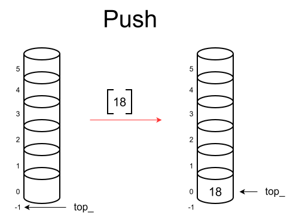
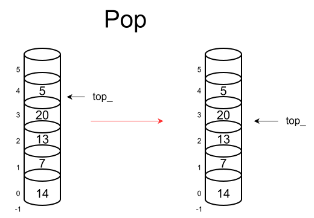

# class Stack (на массиве)

Stack — это абстрактный тип данных, реализующий структуру «последним пришёл — первым вышел» (LIFO — Last In, First Out). Он хранит элементы в непрерывном участке памяти (массиве) и предоставляет доступ только к последнему добавленному элементу (вершине стека), обеспечивая быструю вставку и удаление с одного конца.

## Способы возможной реализации

1) **Статический массив:** выделение памяти фиксированного размера на этапе компиляции или инициализации. Прост в реализации, но имеет жесткое ограничение на количество элементов (переполнение стека).
2) **Динамический массив (как std::vector):** элементы хранятся в непрерывном блоке памяти. При исчерпании вместимости (capacity) выделяется новый блок , данные копируются, а старый блок освобождается.

### Ближайший аналог нашей реализации
`std::stack` (в C++ по умолчанию использует `std::deque`, но часто конфигурируется для работы с `std::vector`).

### Выбранный способ реализации
Для разработки выбран **статический массив** , может быть переполнение стека,зато мы экономим время и память, не перевыделяя её и не храним доп классы,вроде вектора 

## Особенности реализации базовых операций

### Вставка

* Добавление в стек (push)

#### Описание алгоритма:
Проверить, есть ли свободная емкость (`top_ < size-1`),если нет - выдать ошибку `stack overflow`.
Увеличить указатель вершины `top_` на 1.
Записать новый элемент по индексу `top_` (который указывает на следующую свободную ячейку).
**Сложность: временная O(1) ,пространственная O(1)**

### Просмотр

* Просмотр вершины (top)
*(Примечание: классический стек не поддерживает операцию произвольного поиска. Если требуется найти элемент в глубине стека, это нарушает абстракцию LIFO и требует линейного перебора за O(N)).*

#### Описание алгоритма:
Проверить, не пуст ли стек (`top_ > -1`).
Вернуть элемент по индексу `top_`.
**Сложность: временная O(1), пространственная O(1).**

### Удаление

* Удаление из стека (pop)

#### Описание алгоритма:
Проверить, не пуст ли стек.
Вернуть текущий элемент на вершине стека на индексу `top`.
Уменьшить указатель вершины `top_` на 1.
**При последующий вставках элемент перезапишется,поэтому удалять вручную его не надо**

**Сложность: временная O(1), пространственная O(1).**

## Таблица сложности

| Операция | Временная сложность (Лучшая) | Временная сложность (Худшая) | Временная сложность (Средняя) | Пространственная сложность (Лучшая) | Пространственная сложность (Худшая) | Пространственная сложность (Средняя) |
| :--- | :---: | :---: | :---: | :---: | :---: | :---: |
| **push (Вставка)** | O(1) | O(1) | O(1) | O(1)| O(1) | O(1) |
| **top (Просмотр)** | O(1) | O(1) | O(1) | O(1) | O(1) | O(1) |
| **pop (Удаление)**| O(1) | O(1) | O(1) | O(1) | O(1) | O(1) |

## Назначение

1. **Обработка вложенных структур и синтаксический анализ**
   Благодаря строгому порядку LIFO, стек идеально подходит для задач, где необходимо «запомнить» контекст и вернуться к нему позже. Это делает структуру незаменимой для:
   * Проверки сбалансированности скобок `()`, `{}`, `[]` в компиляторах и интерпретаторах.
   * Вычисления арифметических выражений (алгоритм сортировочной станции, постфиксная запись / обратная польская запись).
   * Обхода графов в глубину (DFS — Depth-First Search), где стек хранит вершины для возврата (или используется неявно через рекурсию).

2. **Реализация механизмов «Отмены» (Undo/Redo) и истории**
   Каждое действие пользователя сохраняется в стеке. При вызове команды «Отменить» (Undo) последнее действие извлекается из стека (`pop`) и инвертируется. 
   * Редакторы текста, графические редакторы.
   * История навигации в веб-браузерах (кнопка «Назад»).

3. **Системное программирование и управление памятью**
   * **Стек вызовов (Call Stack):** хранение локальных переменных функций, параметров и адресов возврата при вызове функций. Непрерывный массив обеспечивает высокую скорость выделения памяти (просто сдвиг указателя стека) и отличную локальность данных в кэше процессора.
   * **Backtracking (Поиск с возвратом):** алгоритмы решения головоломок (например, Судоку, лабиринты), где стек хранит состояния, к которым можно откатиться в случае тупика.