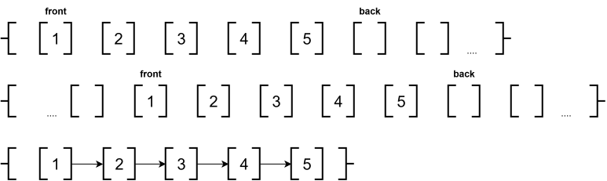
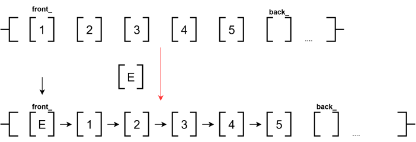
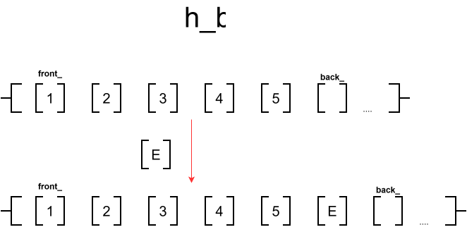
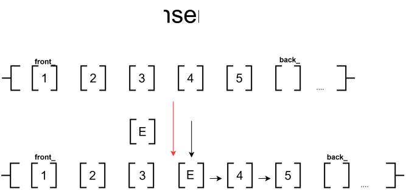
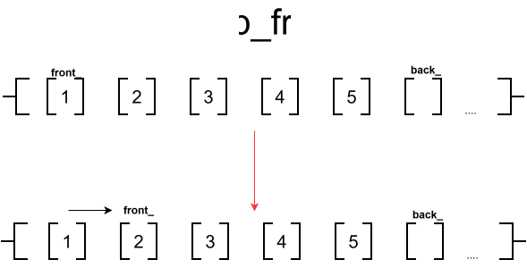
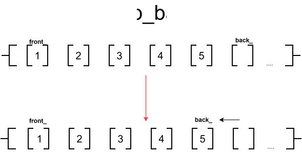
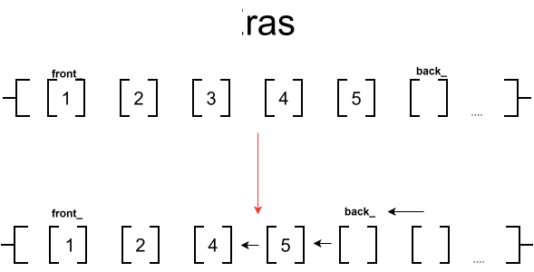

# class Vector

Vector – это шаблонный класс, реализующий структуру данных "динамический массив". Он хранит элементы одного типа в непрерывном участке памяти, обеспечивая быстрый доступ по индексу,автоматическое управление выделением памяти при изменении количества элементов и быструю вставку в конец

## Способы возможной реализации

1) Классический динамический массив (как std::vector): элементы хранятся в одном непрерывном блоке памяти. При исчерпании вместимости (capacity) выделяется новый блок, данные копируются, а старый блок освобождается.
2) Массив с резервом в начале: указатель начала данных (start) может смещаться вглубь выделенного блока, что позволяет реализовать push_front за O(1), но усложняет управление памятью.
3) Фрагментированный массив (как std::deque или LinkList из других языков): массив фиксированных блоков, связанных указателями. Обеспечивает O(1) вставку с обоих концов, но усложняет доступ к элементам по индексу из-за перебора всех элементов до необходимого.

### Ближайши аналог нашей реализации
std::vector

### Выбранный способ реализации
Для разработки выбран классический динамический массив с увеличением емкости (на MEM_STEP - в данной реализации 16).

## Особенности реализации базовых операций

### Вставки

* Вставка в начало (push_front)

#### Описание алгоритма:
Проверить, есть ли свободная емкость (size < capacity). Если нет, выполнить реаллокацию (увеличить capacity на MEM_STEP, выполнить сдвиг элементов вправо в новый массив,старый удалить).
Сдвинуть все существующие элементы на 1 позицию вправо (начиная с конца массива, чтобы не затереть данные).
Записать новый элемент в индекс 0.
Увеличить указатель на конец(back_) на 1.
**Сложность: временная O(N), пространственная O(1) (или O(N) в случае реаллокации).**

* Вставка в конец (push_back)

#### Описание алгоритма:
Проверить, есть ли свободная емкость (size < capacity). Если нет, выполнить реаллокацию (увеличить capacity на MEM_STEP,выделить новую память под изменённую capacity,удалить старый массив)
Записать новый элемент по индексу size.
Увеличить указатель на конец(back_) на 1.
**Сложность: временная O(1) амортизированная (O(N) в худшем случае при реаллокации), пространственная O(1) (или O(N) при реаллокации).**

* Вставка в середину (insert)

#### Описание алгоритма:
Проверить индекс,если он совпадает с началом или концом - делегировать методам push_back или push_front
Иначе(вставка точно в середину) проверить емкость и выполнить реаллокацию при необходимости.
Начиная с конца массива, сдвинуть все элементы от позиции вставки до конца на 1 позицию вправо.
Записать новый элемент на освободившуюся позицию.
Увеличить указатель на конец(back_) на 1.
**Сложность: временная O(N), пространственная O(1) (или O(N) при реаллокации).**

### Поиск

* line_search
#### Описание алгоритма:
В общем случае применяется линейный поиск: последовательный перебор элементов от индекса 0 до size - 1 с сравнением каждого элемента с искомым значением.
**Сложность: временная O(N), пространственная O(1).**

### Удаление

* Удаление из начала (pop_front)

#### Описание алгоритма:
Увеличить указатель на первый элемент(front_) на 1
Потом при дефрагментации все встанет на свои места
**Сложность: временная O(1),пространственная O(1).**

* Удаление из конца (pop_back)

#### Описание алгоритма:
Уменьшить указатель на последний элемент(back_) на 1
Потом при дефрагментации все встанет на свои места
**Сложность: временная O(1),пространственная O(1).**

* Удаление из середины (erase)

#### Описание алгоритма:
Проверить индекс,если он совпадает с началом или концом - делегировать методам pop_back или pop_front
Сдвинуть все элементы, находящиеся правее удаляемого, на 1 позицию влево.
Уменьшить back_ на 1.
**Сложность: временная O(N), пространственная O(1).**

## Таблица сложности

| Операция | Временная сложность (Лучшая) | Временная сложность (Худшая) | Временная сложность (Средняя) | Пространственная сложность (Лучшая) | Пространственная сложность (Худшая) | Пространственная сложность (Средняя) |
| :--- | :---: | :---: | :---: | :---: | :---: | :---: |
| **Вставка** | O(1) | O(N) | O(N) | O(1)| O(1) | O(1) |
| **Поиск** |O(N) | O(N) | O(N) | O(1) | O(1) | O(1) |
| **Удаление**| O(1) | O(1) | O(N) | O(1) | O(1) | O(1) |
